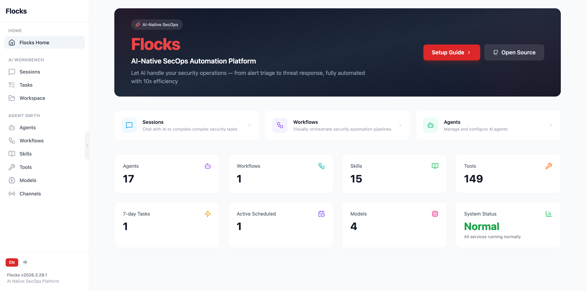

<h1 align="center">Flocks</h1>

<p align="center">
  AI-Native SecOps Platform
</p>

<p align="center">
  <a href="https://agentflocks.github.io/flocks-docs/"></a>
  <a href="LICENSE.txt"></a>
</p>

<p align="center">
  <a href="README.md"></a>
  <a href="README_zh.md"></a>
</p>



## 1. Project Overview

Flocks is an AI-driven SecOps platform built with Python, featuring multi-agent collaboration, HTTP API server, and modern terminal user interface designed to help you with your SecOps tasks.

## 2. Features

- 🤖 **AI Agent System** - Multi-agent collaboration (build, plan, general)
- 🔧 **Rich Tool Set** - bash, file operations, code search, LSP integration, etc.
- 🌐 **HTTP API Server** - High-performance API service based on FastAPI
- 💬 **Session Management** - Session and context management
- 🎯 **Multiple Model Support** - Support for Anthropic, OpenAI, Google and other AI models
- 📝 **LSP Integration** - Language Server Protocol support
- 🔌 **MCP Support** - Model Context Protocol
- 🖼️ **WebUI** - Browser-based web user interface
- 🎨 **TUI Interface** - Modern terminal user interface

## 3. Installation & Usage

Flocks supports two deployment methods — **choose one**:

| Method | Description |
|---|---|
| 3.1 PC Installation | Recommended for local development and production deployment |
| 3.2 Docker Installation | Out-of-the-box, but agent-browser headed mode is currently unavailable |

### 3.1 Option 1: PC Installation

#### 3.1.1 System Requirements

- `uv`
- `Node.js` with `npm` 22.+
- `agent-browser`
- `bun` for TUI installation (Optional)

By default, the project install scripts will try to ensure the requirements above are available automatically when possible.

If automatic `npm` installation fails during setup, please install `npm` manually and use version `22.+` or newer.

#### 3.1.2 Install

> The following installation options are supported. **Choose one** to complete the installation, then proceed to 3.1.3 Start service.

---

**Option A: Install with one command (recommended)**

> [!NOTE]
> **Users in mainland China**: Please follow the installation instructions in the [简体中文](README_zh.md), which provides a mirror-accelerated installation method specifically optimized for users in China.

macOS / Linux
```bash
curl -fsSL https://raw.githubusercontent.com/AgentFlocks/flocks/main/install.sh | bash
```
Creates ./flocks under the current directory

Windows PowerShell (Administrator)
```powershell
powershell -c "irm https://raw.githubusercontent.com/AgentFlocks/flocks/main/install.ps1 | iex"
```

---

**Option B: Install from source code**

If you prefer to inspect the repository before installation, clone it locally and run the installer from the workspace:

```bash
git clone https://github.com/AgentFlocks/Flocks.git flocks
cd flocks
```

macOS / Linux
```bash
sh ./scripts/install.sh
```

Windows PowerShell (Administrator)
```powershell
powershell -ep Bypass -File .\scripts\install.ps1
```

---

**Option C: Windows installer (EXE, BETA)**

Flocks provides an **Inno Setup** wizard (`.exe`) for **Windows x64**. Download the installer for your version from the [GitHub Releases](https://github.com/AgentFlocks/flocks/releases) page.

| Platform | Download |
| --- | --- |
| Windows (x64) | `FlocksSetup-<tag>.exe` |

After installation, use the **Start menu** or optional **desktop** shortcut, or open a **new** terminal and run `flocks start` so updated `PATH` and related environment variables take effect. For more details, see [`packaging/README.md`](packaging/README.md).

---

#### 3.1.3 Start service

Use the `flocks` CLI to manage the backend and WebUI together in daemon mode.
The `start` command builds the WebUI before launch by default; use `flocks restart` when you want an explicit full restart.

```bash
flocks start
flocks status
flocks logs
flocks restart
flocks stop
```

The default service address is:
- Flocks WebUI: `http://127.0.0.1:5173`
- Remote access configurable via `flocks start --host <ip>`

Flocks CLI usage: `flocks --help`

### 3.2 Option 2: Docker Installation

> [!NOTE]
> In the Docker installation, the agent-browser headed mode is currently unavailable.

#### 3.2.1 Pull image

```bash
docker pull ghcr.io/agentflocks/flocks:latest
```

#### 3.2.2 Start service

Run the container and mount the host user's `~/.flocks` directory into the container:

macOS / Linux
```bash
docker run -d \
  --name flocks \
  -p 5173:5173 \
  -e TZ=Asia/Shanghai \
  --shm-size 4gb \
  -v "${HOME}/.flocks:/home/flocks/.flocks" \
  ghcr.io/agentflocks/flocks:latest
```

Windows PowerShell
```powershell
docker run -d `
  --name flocks `
  -p 5173:5173 `
  -e TZ=Asia/Shanghai `
  --shm-size 4gb `
  -v "${env:USERPROFILE}\.flocks:/home/flocks/.flocks" `
  ghcr.io/agentflocks/flocks:latest
```

`EXPOSE` in the image only documents container ports. You still need `-p 5173:5173` to access the service from the host browser.

The image does not set a time zone (containers default to UTC), so pass `-e TZ=<your zone>` if scheduled tasks should display local times.

## 4. FAQ

### 4.1 For Users in China: Speed Up Python Package Installation

On machines in mainland China, you can configure `uv` to use a local PyPI mirror for faster package downloads.

Create `~/.config/uv/uv.toml` with:

```toml
[[index]]
url = "https://pypi.tuna.tsinghua.edu.cn/simple"

[[index]]
url = "https://pypi.org/simple"
default = true
```

### 4.2 Docker Issues

Docker registry mirror in China

- 1ms GHCR: `docker pull ghcr.1ms.run/agentflocks/flocks:latest`
- dockerproxy GHCR: `docker pull ghcr.dockerproxy.net/agentflocks/flocks:latest`
- gh-proxy prefix: `docker pull docker.gh-proxy.com/ghcr.io/agentflocks/flocks:latest`
- milu GHCR: `docker pull ghcr.milu.moe/agentflocks/flocks:latest`
- NJU GHCR: `docker pull ghcr.nju.edu.cn/agentflocks/flocks:latest`

Permission issues for `/home/flocks/.flocks` after startup:

``` bash
-v "$HOME/.flocks:/home/flocks/.flocks:Z" \
```
OR
```bash
docker run --rm --entrypoint id ghcr.io/agentflocks/flocks
# example result: uid=1001(flocks) gid=1001(flocks) 组=1001(flocks)
sudo chown -R <uid>:<gid> ~/.flocks
# example: sudo chown -R 1001:1001 ~/.flocks
```

### 4.3 Remote Access to Flocks Service
```bash
flocks start --host 0.0.0.0
```
If remote access from a virtual machine fails, please specify the host as the virtual machine's IP.

The WebUI and API share the same service address and port. API requests use the
same-origin `/api` path, keeping browser cookies and SSE on a single origin for
LAN access and reverse-proxy deployments.

Only enable direct browser-to-backend URLs when you explicitly need them:

```bash
FLOCKS_WEBUI_DIRECT_BACKEND_URLS=1 \
flocks start --server-host 0.0.0.0 --webui-host 0.0.0.0
```

### 4.4 Authentication & API Token

Since the local-account update, every HTTP path is protected by default — only
the WebUI bootstrap pages (`/`, `/auth/*`), static assets, and IM platform
webhooks (`/api/channel/{channel_id}/webhook`) are public.

Initial setup:

1. Open the WebUI and complete the **bootstrap-admin** flow to create the
   single `admin` account.
2. The browser session cookie (`flocks_session`) is enough for the WebUI;
   no extra steps are required.

Non-browser clients (TUI, SDKs, scripts):

- All non-browser clients, including local loopback clients, must present an
  API token. The token lives in `~/.flocks/config/.secret.json` under the
  secret id `server_api_token`.

  On the **server**, generate (or rotate) the token — it is persisted on
  the server's local secret store:

  ```bash
  flocks admin generate-api-token        # prints token; stores under server_api_token
  ```

  On each **remote client**, store the same token value into the client's
  own secret file (so the client SDK / TUI can attach it automatically):

  ```bash
  flocks admin set-api-token --token <token-from-server>
  ```

  Or attach it directly per request via either header:

  ```text
  Authorization: Bearer <token>
  X-Flocks-API-Token: <token>
  ```

  Smoke test:

  ```bash
  curl -H "Authorization: Bearer <token>" https://flocks.example.com/api/health
  ```

  Query the live runtime status of a specific session:

  ```bash
  curl -H "Authorization: Bearer <token>" \
    https://flocks.example.com/api/session/<sessionID>/status
  ```

  `status.type` is one of `idle`, `queued`, `busy`, `retry`, `compacting`, or
  `dreaming`. Automation clients can use `isProcessing` to determine whether
  accepted work is still running or waiting. `idle` only means that the session
  is currently inactive; it does not indicate whether the previous run succeeded.

Reverse-proxy deployments:

- Always set `X-Forwarded-For` on the proxy. Without it, any direct
  loopback request would be auto-elevated to `admin`. The middleware
  intentionally refuses to trust loopback when this header is absent and a
  proxy is in front.
- For HTTPS termination, also forward `X-Forwarded-Proto: https` so that
  the secure-cookie flag is set correctly.
- Prefer same-origin proxying for browser traffic: keep the WebUI on `/` and
  route backend traffic through `/api` (and `/event` if needed). Do not set
  `VITE_API_BASE_URL` in reverse-proxy deployments unless you intentionally
  want the browser to bypass the proxy and talk to the backend origin directly.
- For SSE endpoints, disable proxy buffering and keep HTTP/1.1 enabled. 

Recovery / lost password:

- Run `flocks admin generate-one-time-password` on the host. The admin
  account is then forced into `must_reset_password=true`; the next WebUI
  login is redirected to the change-password page. **All non-browser
  endpoints return 403 in that state**, so do not run this against an
  account that automation depends on without coordination.

Orphan sessions (CLI / background / inbound channels):

- Sessions created without an auth context (CLI commands, background
  tasks, inbound IM-channel dispatchers) leave `owner_user_id` empty.
  The bootstrap admin still sees them, but a later-added member account
  would not. Backfill ownership with:

  ```bash
  flocks admin reassign-orphan-sessions --username admin --dry-run   # preview
  flocks admin reassign-orphan-sessions --username admin             # apply
  ```

  The command summarises `scanned / orphaned / reassigned / failed`
  counts; a non-zero `failed` exits with code 2 so CI / scripts can
  detect partial-write situations and re-run after fixing the underlying
  cause (typically a transient storage error).

### 4.5 Outbound Proxy (HTTP / HTTPS / SOCKS) and Direct-Connection Whitelist

Every outbound request the backend makes — model APIs, IM platforms (Slack, Telegram,
Feishu, DingTalk, WeCom, WeChat), the plugin hub, update checks, remote MCP servers,
web fetch / search, headless Chrome and child processes such as `git` / `uv` / `npm` —
follows one policy. Configure it in the WebUI under **Settings → Network proxy**
(admin only), in `flocks.json`, or with environment variables:

```jsonc
"network": {
  "proxy": {
    "mode": "manual",                      // off | system (default) | manual
    "http": "http://127.0.0.1:7890",       // for http:// targets
    "https": "socks5h://127.0.0.1:7891",   // for https:// and wss:// targets
    "all": "",                             // fallback when http / https are empty
    "username": "",
    "password": "{secret:network_proxy_password}",   // stored via the secret manager, never in plain text
    "bypass": ["*.corp.example", "10.0.0.0/8", "gitlab.internal:8443"],
    "bypassPrivate": true
  }
}
```

- `system` follows `HTTP_PROXY` / `HTTPS_PROXY` / `ALL_PROXY` / `NO_PROXY` exactly as exported.
  `manual` uses the URLs above and exports them to the process, so libraries that trust the
  environment and child processes see the same thing. `off` hides those variables and connects directly.
- Accepted schemes: `http`, `https`, `socks5`, `socks5h` (`socks5h` lets the proxy resolve names). A URL without a port gets the conventional one (80 / 443 / 1080).
- Whitelist rules (checked before any DNS lookup): `*.corp.example` / `.corp.example` (domain and
  subdomains), `host`, `host:port`, an IP, a CIDR block (`10.0.0.0/8`, `fd00::/8`), `<local>`
  (hostnames without a dot) and `*` (everything direct). With `bypassPrivate` on, link-local,
  RFC1918, IPv6 ULA and `*.local` / `*.internal` / `*.lan` / `*.home.arpa` go direct without being
  listed. `localhost` / `127.0.0.0/8` / `::1` always connect directly (add `<-loopback>` to the
  list only if you really want loopback proxied).
- Environment overrides for systemd units and containers: `FLOCKS_PROXY_MODE`, `FLOCKS_PROXY_URL`
  (used for http, https and all) and `FLOCKS_PROXY_BYPASS` (comma separated). The section is read from
  the user-level `flocks.json` only (not from a `FLOCKS_CONFIG` file or `FLOCKS_CONFIG_CONTENT`).
- `POST /api/config/network/proxy/test` (or the **Test** button) reports whether a URL went direct
  or through which proxy, with the HTTP status and latency.

Known limits: libraries that only read the environment (litellm, lark-oapi, python-telegram-bot, `git`, `pip`)
understand `NO_PROXY` by host name and suffix, not by CIDR block, so an intranet target reached through
them needs its host name (or `.suffix`) in the whitelist; flocks' own clients apply CIDR and port rules
before DNS. The WhatsApp bridge's websocket and media uploads follow the policy (http and socks),
but media *downloads* use Node's native `fetch`, which honours `HTTP_PROXY` only on Node ≥ 24 and
only for http proxies — with a SOCKS-only policy they go direct. The same goes for the TUI (Bun):
it follows `HTTP_PROXY` / `NO_PROXY` but rejects `socks://`, so it is started without SOCKS entries.
Headless Chrome takes the proxy without credentials (`--proxy-server` has no auth).

## 5. Join our community

Scan the QR code with **WeChat** to join our official discussion group.  


## 6. Contributing

See [`CONTRIBUTING.md`](CONTRIBUTING.md) for development setup, coding standards, testing expectations, and Pull Request guidelines.

## 7. License

Apache License 2.0
